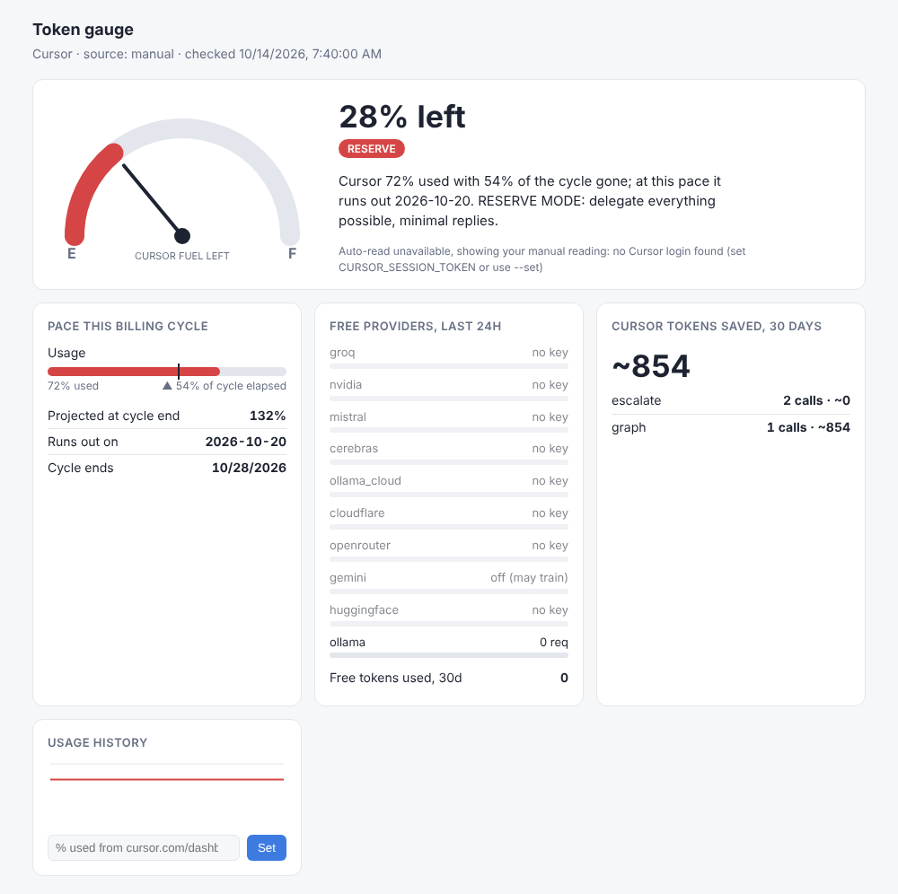

# tokengate

**Free compute first, paid Cursor tokens last.** tokengate sits in front of Cursor. It answers your chat message with a code graph ([graphify](https://graphify.com)), a cache, or free cloud APIs (Groq, NVIDIA, Mistral, Cerebras, OpenRouter…). Cursor's own model only runs when all of those fail. A fuel gauge shows how much Cursor usage you have left and when you'll run out.



## How Cursor is kept from going first

Cursor's chat model normally reads every message *before* it decides to call a tool, so an MCP server alone can't stop that first spend. tokengate adds a **front door** using Cursor's `beforeSubmitPrompt` hook (`.cursor/hooks.json`):

```
your message ──► tokengate hook ──► free model did it?  ── yes ──► prompt blocked, Cursor model never runs (0 tokens)
                                    │                                answer in popup + .tokengate/last_answer.md
                                    │                                edits already on disk (git diff)
                                    └─ no / not suitable ──► Cursor runs; .tokengate/HANDOFF.md has the context
```

- **`prompt_gate = "always"`** (default) tries free models on every self-contained message.
- **`"auto"`** only intercepts *explain, summarize, review, write tests, add docs*, and small edits in files you name. **`"off"`** disables the hook.
- Messages that rely on chat history ("yes do it", "fix the error above") always go to Cursor, because a fresh model can't see the chat.
- When the fuel gauge is in **reserve**, `auto` behaves like `always`.
- Start a message with **`!`** to send it straight to Cursor.
- The hook **fails open**: if it errors, your message goes to Cursor as usual.

Inside Cursor's turn, the MCP tools and an `alwaysApply` rule keep it cheap: graph outlines instead of whole files, `delegate` for writing, and `run_checks` for verifying.

## The escalation ladder

| Tier | What | Cost |
|---|---|---|
| 0 | Code graph: graphify call graph (callers, callees, impact, call paths) plus file outlines; ripgrep; local `tsc`/`eslint`/`ruff`/`pytest` | free |
| 1 | Cache: same task on the same code gives the same answer | free |
| 2 | Free cloud APIs, in `tokengate.toml` order, each with its own per-minute and daily caps | free quota |
| 3 | Local model via Ollama (offline fallback) | free |
| 4 | Cursor, handed a minimal context pack | paid, last |

Free models can refuse with `ESCALATE: reason`. An edit is all-or-nothing (every `SEARCH` block must match exactly), and it is rolled back if typecheck or lint errors go up. Each failure moves on to the next model.

## Free API providers (pre-configured)

Add a key and the provider joins the ladder. A provider with no key is skipped. They're tried in this order: strong and fast first, the small local model last. Limits are as reported in October 2026, and tokengate's defaults sit slightly under them. **Free tiers change often**, so check each console.

| # | Provider | How to get a key | Effort | Free limits (approx.) | Env var |
|---|---|---|---|---|---|
| 1 | **Groq** | console.groq.com: sign in with email, Google or GitHub, then "Create API Key". No card. | ⭐ 2 min | ~30 RPM, ~1,000 req/day per model | `GROQ_API_KEY` |
| 2 | **NVIDIA NIM** | build.nvidia.com: join the NVIDIA Developer Program, open any model, then "Get API Key". Phone check reported. | ⭐⭐ 5 min | ~40 RPM (one list says 10,000/day) | `NVIDIA_API_KEY` |
| 3 | **Mistral** | console.mistral.ai: create an account, verify your phone, pick the free plan, then API Keys. No card. | ⭐⭐ 5 min | ~1 req/s, large monthly token allowance; **trains on prompts** (allowed in config) | `MISTRAL_API_KEY` |
| 4 | **Cerebras** | cloud.cerebras.ai: email signup, no card. | ⭐ 2 min | reported inconsistently; defaults kept low | `CEREBRAS_API_KEY` |
| 5 | **Ollama Cloud** | ollama.com: create an account, then Settings → API keys. | ⭐ 2 min | session and weekly limits (amounts unpublished) | `OLLAMA_API_KEY` |
| 6 | **Cloudflare Workers AI** | dash.cloudflare.com: free account. Copy the Account ID, then create an API token with "Workers AI" permission. | ⭐⭐ 5 min (2 values) | 10,000 Neurons/day | `CLOUDFLARE_API_TOKEN` + `CLOUDFLARE_ACCOUNT_ID` |
| 7 | **OpenRouter** | openrouter.ai: email or Google signup, then Keys. No card. | ⭐ 2 min | `:free` models 20 RPM, 50/day; **1,000/day after a one-time $10 top-up** | `OPENROUTER_API_KEY` |
| 8 | Gemini | aistudio.google.com: Google account, then "Get API key". | ⭐ 1 min | Flash and Flash-Lite; limits shown only in AI Studio; **trains on prompts** outside EEA/UK/CH (off by default) | `GEMINI_API_KEY` |
| 9 | Hugging Face | huggingface.co: Settings → Access Tokens. | ⭐ 1 min | only ~$0.10/month of credits | `HF_TOKEN` |
| 10 | Ollama (local) | ollama.com/download, then `ollama pull qwen2.5-coder:7b` | ⭐⭐ | unlimited, private, offline | – |

**Best value for little effort:** Groq, OpenRouter, NVIDIA and Mistral. Together that's about 15 minutes of sign-ups and thousands of free requests a day. If you hit OpenRouter's 50/day, a one-time $10 top-up raises it to 1,000/day.

**Left out on purpose:**
- **GitHub Models** was retired on 30 July 2026.
- **Cohere** (1,000 calls a month, non-commercial only).
- **SiliconFlow and ModelScope** (identity verification).
- **Anonymous gateways** (Kilo, LLM7, OVH anonymous), which may log prompts and have tight per-IP limits.

To allow a provider that trains on prompts, add its name to `allow_training` (Mistral is already there). Run `tokengate models` to list the real model IDs each key can use. For new or changed free tiers, see [cheahjs/free-llm-api-resources](https://github.com/cheahjs/free-llm-api-resources) and [mnfst/awesome-free-llm-apis](https://github.com/mnfst/awesome-free-llm-apis).

## Cursor settings that matter most

tokengate cuts what Cursor *reads* and *writes*. These Cursor settings decide what each message *costs*:

1. **Point Cursor's chat at a free provider (biggest lever).** Go to *Settings → Models*, paste a Groq or OpenRouter key into **OpenAI API Key**, turn on **Override OpenAI Base URL** (`https://api.groq.com/openai/v1` or `https://openrouter.ai/api/v1`), and add the model names. Chat then runs on that provider with **no Cursor usage**.
   - Reports disagree on whether **Agent** mode works with a custom key, so test it on your version. Tab autocomplete always uses Cursor.
   - The override is global, and the requests go through Cursor's servers, so a `localhost` URL won't work.
2. **Use Auto** for routine work. Avoid manually picking premium, *MAX* or "thinking" models; they burn the pool fastest.
3. **Start a new chat per task.** Every message re-sends the whole conversation, so a long chat costs more on each turn.
4. **Set a spend limit** (Dashboard → Spending) so Cursor doesn't silently switch to paid on-demand usage when the pool runs out.
5. **Keep `.cursorignore` tight.** `tokengate init` adds `node_modules`, `android/`, `ios/`, lockfiles and media.

Measured on this project, tokengate's own fixed cost per Cursor message (5 tool definitions plus the always-on rule) is about **690 tokens, down from about 1,580** in the first version.

## Fuel gauge

```bash
tokengate gauge                      # E [████████······················] F  28% left  … runs out 2026-10-19
tokengate gauge --set 72 --cycle-end 2026-10-28   # manual reading from cursor.com/dashboard
tokengate dashboard                  # http://127.0.0.1:8765 (gauge, pace vs cycle, free-provider caps, savings)
tokengate install-statusbar          # ▮▮▯▯▯ 28% in Cursor's status bar, turns red in reserve
```

- **Cursor usage** is read the way community trackers do it (MIT-licensed [cursor-usage-tracker](https://github.com/Tendo33/cursor-usage-tracker)): Cursor's own login token from its local `state.vscdb`, sent read-only to the `cursor.com/api/usage-summary` endpoint the dashboard uses. **This endpoint is unofficial and can change.** If auto-read fails, set `CURSOR_SESSION_TOKEN` (the `WorkosCursorSessionToken` cookie from your browser) or use `--set`. Readings are cached for 5 minutes.
- **Forecast**: a linear burn rate over the billing cycle, giving "projected % at cycle end" and "runs out on".
- **Levels**: `ok` → `warn` (≥ 60%, or the pace overshoots) → `reserve` (≥ 85%, or the pace is far over) → `empty`. Thresholds live in `tokengate.toml`. From `warn` upward, every tokengate tool output starts with a `[gauge …]` line telling Cursor's agent to economise.
- **Free providers**: none of them expose remaining quota, so the gauge shows tokengate's own usage against each provider's caps.

## Install

```bash
pip install "git+https://github.com/<you>/tokengate.git#egg=tokengate[mcp]"   # or: pip install -e ./tokengate[mcp]
cd your-project
tokengate init      # tokengate.toml, .cursor/{mcp.json,hooks.json,rules/tokengate.mdc}, .cursorignore, graphify graph
tokengate models    # check model IDs per provider
```

Set the API keys you have as environment variables. On Windows: `setx NVIDIA_API_KEY "nvapi-..."`. Then restart Cursor and turn on **tokengate** under *Settings → MCP*. Run `tokengate init` on each machine, because it writes that machine's Python path into the Cursor configs.

## MCP tools

Cursor's model sees only five tools, kept short because their definitions are re-sent with every message:

| Tool | Does |
|---|---|
| `code(op, q, q2)` | `map` repo overview · `file` outline with line numbers · `find` definition · `explain` callers and callees with lines (graphify) · `impact` what breaks (graphify) · `path` call chain A→B (graphify) · `hubs` most-connected symbols · `pack` minimal context for a task · `search` ripgrep |
| `delegate(task, files, kind)` | free models do the work; edits are validated and rolled back on failure |
| `distribute(task, glob, kind)` | same task across many files, in parallel on free models |
| `check()` | local typecheck, lint and tests; returns failures only |
| `gauge_status()` | quota left, forecast, free-provider use, tokens saved |

## CLI

```bash
tokengate viz                     # .tokengate/graph.html (interactive), graph.mmd, REPO_MAP.md
tokengate query explain "detectMisquote()"      # also: map | file X | find X | impact X | path A B | hubs | pack "task" | search regex
tokengate ask "explain the search pipeline" -k explain
tokengate ask "add input validation to parseReference" -f Layer1_ReferenceParser.ts -k edit
tokengate fanout "list bugs and a11y issues" "src/screens/**/*.tsx" -k review
tokengate check | stats | gauge | dashboard
```

## Prior art (what to borrow next)

| Project | What it does well | How tokengate relates |
|---|---|---|
| [graphify](https://graphify.com/integrations/cursor) (PyPI `graphifyy`, MIT) | tree-sitter AST graph, MCP server, `graphify cursor install`, ~7–50x fewer tokens in independent tests | **now tokengate's graph engine**: AST call graph for 20+ languages, ~1.4 s incremental rebuild. tokengate wraps its CLI and trims its output |
| aider repo map | tree-sitter tags + PageRank, budget-fitted map | tokengate's `rank()` is a lightweight version; PageRank is the upgrade path |
| [Local Worker MCP](https://glama.ai/mcp/servers/xcj1rfla17), [Claude Code Token Saver](https://mcp.so/servers/cc_token_saver_mcp), [Ultimate MCP / llm_gateway](https://glama.ai/mcp/servers/Dicklesworthstone/llm_gateway_mcp_server) | delegate mechanical work to cheap or local models | tokengate adds edit validation, rollback, per-provider caps and the prompt-gate hook |
| [cursor-usage-tracker](https://github.com/Tendo33/cursor-usage-tracker) (MIT), cursor-stats (archived) | Cursor usage in the status bar | the gauge reuses their documented approach (no code copied) |

## Limits

- `beforeSubmitPrompt` can block, but not rewrite, a prompt. Forum reports mention a double popup and occasional non-blocking in some Cursor versions, so test it on yours. Cursor's hook timeout applies: very slow free models can let the prompt through.
- Cursor's agent still chooses whether to call MCP tools. The rule strongly encourages it but can't force it.
- Savings figures are estimates (characters / 4).
- Delegated edits come from smaller models. Review the `git diff`.

## Tests

```bash
pip install pytest && pytest -q
```
